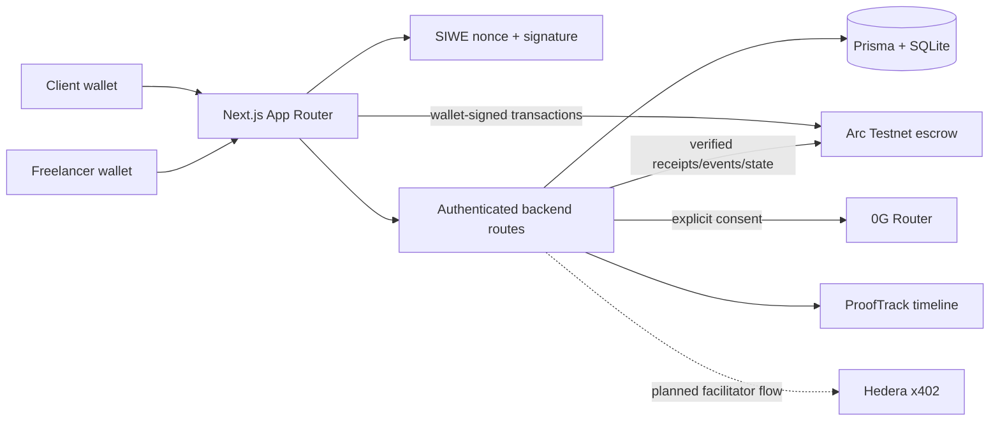

# TRUSTORA

**Trust Every Transaction. Secure Every Promise.**

TRUSTORA is a wallet-authenticated marketplace and milestone escrow workflow for clients and freelancers:

```text
AGREE → FUND → WORK → EVALUATE → VERIFY → RELEASE → BUILD REPUTATION
```

This repository contains a working Arc Testnet prototype, role-separated Client/Freelancer workspaces, marketplace applications, server-side authorization, advisory 0G evaluation adapters, Hedera x402 primitives, and ProofTrack evidence records.

> **Current readiness:** suitable for a testnet hackathon demonstration and mentor feedback. It is not a production release. Arc escrow has been demonstrated on Arc Testnet with two wallets. 0G live inference and Hedera facilitator-backed settlement still require credentials and/or remaining integration work.

## What is working

### Arc Testnet escrow

The complete two-wallet flow has been manually demonstrated on Arc Testnet:

1. Client wallet authenticates.
2. Freelancer wallet authenticates separately.
3. Client and freelancer accept/sign the agreement.
4. Project and milestone are registered.
5. Client funds the milestone.
6. Freelancer submits a deliverable.
7. Deliverable hash is anchored on Arc.
8. Client releases the milestone.

The demonstrated on-chain state was:

```text
REGISTERED → FUNDED → SUBMITTED → RELEASED
```

The application verifies receipts, contract events, actors, identifiers, and contract state before recording Arc results. The browser wallet signs transactions; the server does not hold user private keys.

### Wallet authentication and roles

- Client/Freelancer role selection before sign-in.
- SIWE-style nonce and signature authentication.
- Role is bound into the signed message.
- One normalized wallet address can have one permanent primary role.
- Server-side HttpOnly sessions; no authentication token in localStorage.
- Account and chain change handling.
- MetaMask error handling for rejected, unauthorized, disconnected, and wrong-chain states.
- Client and Freelancer navigation/workspaces are separated.

### Marketplace

- Client project creation with exact USDC base units.
- Draft projects remain private.
- Explicit client publication.
- Published-only freelancer marketplace.
- Search, skill filtering, and budget filtering.
- Published project detail pages.
- Freelancer applications with duplicate protection.
- Client application inbox.
- Atomic approve/reject decisions.
- Approved freelancer assignment is persisted in the database.

### Backend authorization

The backend is the source of truth. Frontend role labels never grant access.

- `requireSession()` validates the server session and mutation origin.
- `requireAccountRole()` checks the persisted account role.
- Project routes verify client ownership, freelancer assignment, or arbiter access.
- Wallet addresses supplied by the frontend cannot override the authenticated session wallet.
- Draft marketplace data is not returned to unrelated wallets.
- Application review is limited to the project owner.
- Freelancer application routes are limited to persisted Freelancer accounts.
- Nonces are single-use, address-bound, role-bound, expiring, and rate-limited.
- Authenticated mutations use persistent SQLite-backed rate-limit buckets.
- Financial values use exact integer/string representations instead of unnecessary floating-point calculations.

Important backend routes include:

| Route | Purpose |
| --- | --- |
| `POST /api/auth/nonce` | Issue an address/role-bound SIWE nonce |
| `POST /api/auth/verify` | Verify signature, role, domain, chain, nonce, and create session |
| `GET /api/auth/session` | Return the authenticated wallet and persisted role |
| `POST /api/projects` | Client-only project creation |
| `POST /api/projects/:id/publish` | Client-only publication |
| `GET /api/marketplace` | Freelancer-only published project discovery |
| `GET /api/marketplace/:id` | Freelancer-only published project detail |
| `POST /api/marketplace/:id/apply` | Freelancer-only application |
| `GET /api/applications/mine` | Authenticated freelancer applications |
| `GET /api/applications/received` | Authenticated client applications |
| `POST /api/projects/:id/applications/:applicationId` | Atomic client approval |
| `DELETE /api/projects/:id/applications/:applicationId` | Atomic client rejection |
| `/api/projects/:id/milestones/*` | Role- and assignment-gated escrow workflow |

## Technology tracks

### Arc

**Responsibility:** USDC milestone escrow and settlement on Arc Testnet.

Implemented:

- `TrustoraEscrow.sol`
- Arc Testnet configuration, chain ID `5042002`
- USDC six-decimal amount handling
- Deployment preflight and post-deployment checks
- Wallet-signed project registration, milestone registration, funding, submission, release, dispute, and refund flows
- Receipt/event/state verification
- ProofTrack correlation for verified Arc events
- Hardhat contract tests

Status:

- **Working and manually verified on Arc Testnet:** the complete two-wallet escrow lifecycle.
- A fresh checkout still requires a valid `ESCROW_CONTRACT_ADDRESS` in the web environment before chain actions are enabled.
- Do not deploy or broadcast from this README. Deployment remains an explicit operator action.

### 0G

**Responsibility:** genuine criteria-based AI evaluation of deliverables.

Implemented:

- 0G Private Computer Router adapter for qualifying evaluations (the broker adapter remains legacy tooling only).
- Explicit evaluation consent.
- Criteria-bound structured evaluation.
- Verdicts: `PASS`, `PARTIAL`, `FAIL`, `UNABLE_TO_ASSESS`.
- Evidence, findings, limitations, provider metadata, and request IDs.
- Prompt-injection resistance tests.
- AI output remains advisory and cannot release escrow.

Status:

- **Implemented and tested with mocks.**
- **Live inference is not claimed until a genuine 0G provider response is captured.**
- Missing/invalid credentials produce an honest unavailable result; the application must not fabricate a request ID, verdict, or TEE result.

To make 0G demonstrable:

1. Obtain an authorized 0G Router credential for the configured environment.
2. Configure the variables listed below in an ignored local environment file.
3. Restart the Next.js server.
4. Run an evaluation against a real deliverable with explicit consent.
5. Preserve the provider request ID and response metadata as evidence.
6. Demonstrate that the evaluation cannot call release or move escrow funds.

### Hedera x402

**Responsibility:** exact HBAR/tinybar payments for agent services, using a facilitator and Mirror Node verification.

Implemented primitives:

- Official `@x402/core` and `@x402/hedera` v2 exact client/facilitator wiring.
- Service discovery and standard HTTP 402 payment-required responses.
- Agent-side Hedera payment-payload creation (testnet, HBAR, tinybars).
- Integer tinybar conversion and validation.
- Spending policy helpers.
- Persistent budget reservations, idempotency, and payment lifecycle records.
- Mirror Node settlement verification helpers.
- Hashscan URL helpers.
- ProofTrack settlement correlation when a project ID is supplied.
- Authenticated payment-history API and frontend status/history display.
- Unit tests with mocked facilitator/Mirror Node responses.

The web integration is deliberately fail-closed:

1. `/api/agent-services` exposes only configured services.
2. A protected service returns an x402 v2 `PAYMENT-REQUIRED` challenge.
3. Missing facilitator configuration returns `NOT_CONFIGURED`; it never simulates success.
4. Policy, persistent budget reservation, facilitator verification, settlement, and Mirror Node verification run in that order.
5. ProofTrack records a facilitator ID only when the facilitator returns a valid Hedera transaction ID.

Status: **x402 v2 application workflow implemented and mocked-testable; genuine Hedera settlement still requires funded testnet accounts and explicit approval.**

## ProofTrack

ProofTrack stores the evidence timeline across Arc, 0G, Hedera, and TRUSTORA events.

- Arc events are recorded as verified only after receipt, contract, event, actor, identifier, and state checks.
- 0G request IDs are provider request IDs, not blockchain transaction hashes.
- Hedera evidence must come from verified Mirror Node settlement.
- Database application events are not automatically blockchain proof.
- There is no public ProofTrack verification portal yet.

## Architecture



### Repository structure

```text
apps/web/                 Next.js frontend, backend routes, Prisma database
apps/web/src/app/api/     Authenticated API route handlers
apps/web/src/lib/         Sessions, SIWE, Arc verification, escrow persistence
apps/web/src/components/  Wallet, auth, dashboard, project and workflow UI
apps/web/prisma/          SQLite schema and safe database update tooling
packages/contracts/       Solidity escrow, Hardhat config, deployment checks
packages/og/              0G Router/broker adapters
packages/evaluation/      Structured advisory evaluation logic
packages/hedera/          x402/tinybar/policy/Mirror Node primitives
packages/prooftrack/      Evidence taxonomy and verification helpers
docs/                     Architecture, deployment, security, and demo notes
```

## Local setup

Requirements:

- Node.js 20.9+
- npm
- MetaMask for browser wallet testing
- Arc Testnet configured in MetaMask for wallet workflows

Install and prepare:

```bash
cd "/Volumes/T7 Shield/TrustOra-Anti"
npm ci
npx prisma generate --schema apps/web/prisma/schema.prisma
npm run db:update -w @trustora/web
```

Start the app:

```bash
npm run dev
```

The development script explicitly uses webpack because Next.js 16 defaults to Turbopack while this project has a custom webpack configuration.

Open:

- [http://localhost:3000](http://localhost:3000)
- [http://localhost:3000/register](http://localhost:3000/register)

The safe database updater performs a dry run by default. Review its output before applying changes. Do not use destructive Prisma commands against existing project data.

## Environment variables

Never commit values. Never put private keys in the web application.

### Web application

Configure these only in an ignored local/deployment environment:

- `ARC_RPC_URL`
- `ESCROW_CONTRACT_ADDRESS`
- `ZG_ROUTER_API_KEY`
- `ZG_ROUTER_BASE_URL`
- `ZG_ROUTER_MODEL`
- `ZG_ROUTER_TRUST_MODE`
- `ZG_ROUTER_PROVIDER_ADDRESS`

SQLite is currently fixed by `apps/web/prisma/schema.prisma`; no `DATABASE_URL` is currently used by the web app.

### 0G broker adapter (legacy, non-qualifying)

The broker path is retained for development and direct SDK experiments. It is not used by the milestone evaluation route and does not qualify as TRUSTORA's Private Computer evaluation.

- `ZG_PRIVATE_KEY`
- `ZG_RPC_URL`
- `ZG_PROVIDER_ADDRESS`

Do not expose these values to browser code.

### Arc deployment-only

Only for an explicitly authorized deployment operator:

- `DEPLOYER_PRIVATE_KEY`
- `ARC_RPC_URL`
- `ARC_USDC_ADDRESS`

The web server must never receive `DEPLOYER_PRIVATE_KEY`.

### Hedera

The web server x402 flow reads these variables only from server-side environment configuration:

- `HEDERA_FACILITATOR_ACCOUNT_ID`
- `HEDERA_FACILITATOR_PRIVATE_KEY`
- `HEDERA_SERVICE_RECIPIENT`
- `HEDERA_SECURITY_SCAN_TINYBARS`
- optional `HEDERA_ALLOWED_PROVIDERS`

These settings do not prove settlement. A funded Hedera Testnet facilitator/client and explicit operator approval are still required for a live run. Never place any Hedera private key in frontend-exposed variables.

## Testing and validation

Run:

```bash
npm test
npm run compile:contracts
npm run typecheck
npm run build
git diff --check
```

Current results from the implemented prototype:

- Application/API/package tests: **188 passing**
- Hardhat escrow tests: **15 passing**
- Typecheck: **passing**
- Production build: **passing**
- Diff check: **passing**

Mocked provider tests prove adapter and authorization logic only. They do not prove live 0G inference, live Hedera settlement, or a new Arc deployment.

## Recommended hackathon demo

Use two separate browser profiles:

### Client browser

1. Open `/register`.
2. Select Client.
3. Connect the Client MetaMask account.
4. Sign the SIWE message.
5. Create a project with a small milestone.
6. Publish the project.
7. Review and approve the freelancer application.

### Freelancer browser

1. Open `/register`.
2. Select Freelancer.
3. Connect the Freelancer MetaMask account.
4. Sign the SIWE message.
5. Open Marketplace.
6. Find the published project.
7. Open details and apply.
8. Confirm the application status changes after client approval.

### Arc proof

Use the already verified Arc project to show:

```text
Agreement → Registered → Funded → Submitted → Released
```

Open the explorer links for the verified project, milestone, funding, deliverable anchor, and release. Do not repeat transactions unless testnet funds are intentionally available.

## Two-hour mentor-ready checklist

### Already complete

- [x] Client/Freelancer role separation
- [x] SIWE authentication and server sessions
- [x] Client/Freelancer dashboards
- [x] Marketplace publication and discovery
- [x] Application and approval workflow
- [x] Arc escrow contract and verification flow
- [x] Two-wallet Arc Testnet demonstration
- [x] Exact financial units and authorization checks
- [x] Automated tests, build, and typecheck

### Complete before claiming the corresponding live integration

- [ ] Capture a genuine 0G Router milestone evaluation with a real request ID (requires a submitted and anchored milestone)
- [x] Connect the official Hedera x402 v2 client/facilitator APIs
- [x] Complete mocked Hedera consent, payment, idempotency, policy, and Mirror Node verification paths
- [ ] Fund isolated Hedera Testnet accounts and demonstrate a genuine settlement
- [ ] Add a public ProofTrack verification page
- [ ] Replace local SQLite with managed PostgreSQL for production concurrency
- [ ] Configure production origin, secure cookies, trusted proxy, backups, monitoring, and alerts
- [ ] Run a browser automation suite with MetaMask or a controlled wallet harness

## Production deployment blockers

This prototype should not be presented as production-ready until:

- SQLite is replaced by a persistent production database suitable for concurrent writes.
- A safe migration and backup process is established for that database.
- Rate limiting moves to a deployment-appropriate shared store or trusted edge layer.
- Production origin/domain validation is configured and tested.
- Arc contract address and bytecode/state are independently verified in the deployment environment.
- 0G credentials, provider response handling, and operational limits are configured.
- Hedera facilitator settlement is implemented and independently tested.
- Monitoring, logging redaction, backups, incident response, and security review are established.

## Security boundaries

- Never commit `.env` files, private keys, API keys, or session tokens.
- Never send blockchain transactions without explicit operator/user approval.
- Never treat frontend role or wallet input as authorization.
- Never let AI evaluation release escrow.
- Never fabricate transaction IDs, settlement results, 0G request IDs, or verification status.
- Never expose private drafts or unrelated project/application data.
- Never describe mocked tests as live blockchain/provider evidence.

## Documentation

- [Architecture](docs/ARCHITECTURE.md)
- [Integration status](docs/INTEGRATION_STATUS.md)
- [Deployment runbook](docs/DEPLOYMENT.md)
- [Security status](docs/SECURITY.md)
- [Project status](docs/PROJECT_STATUS.md)
- [Build checklist](docs/BUILD_CHECKLIST.md)
